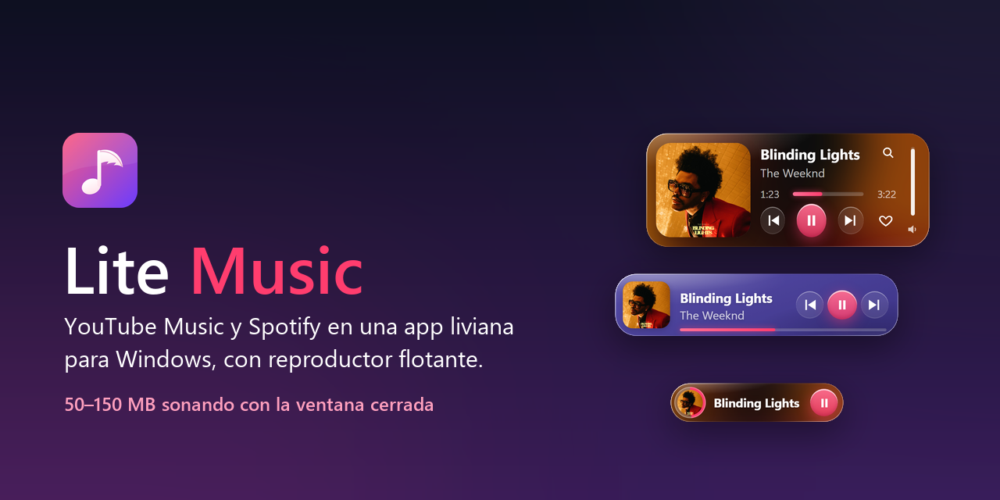
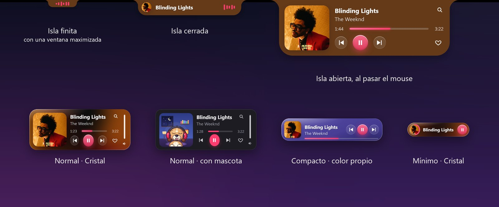
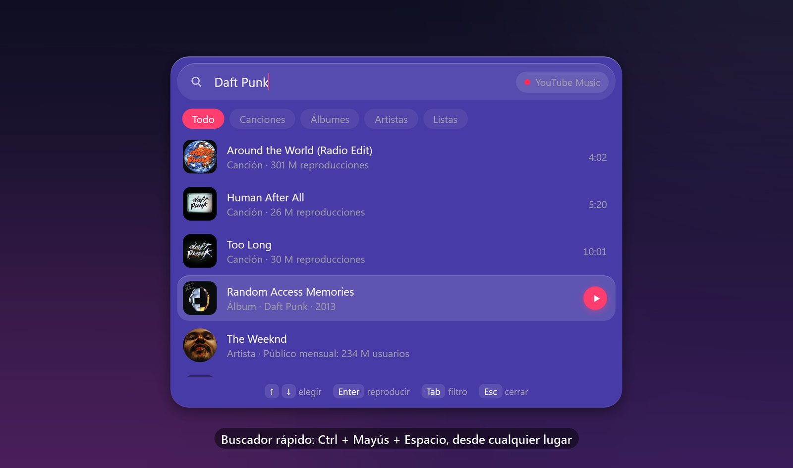
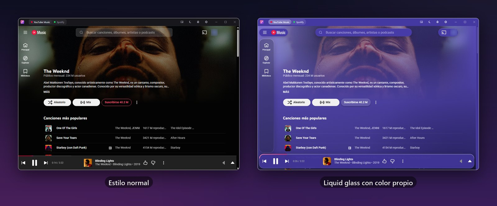
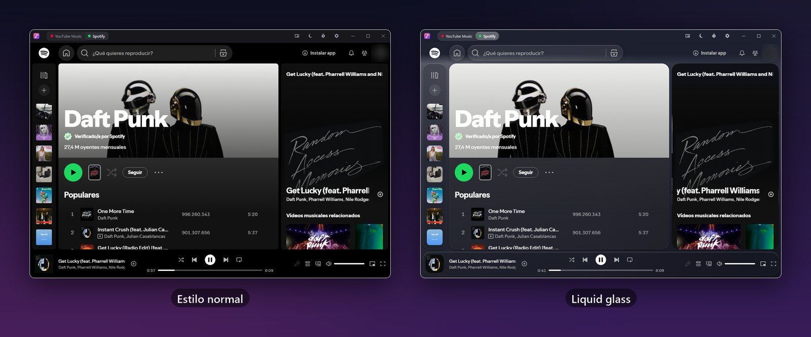

  

  
  
  
  

  <a href="https://github.com/bautista-rubio/lite-music/releases/latest"><b>⬇ Descargar para Windows</b></a>

---

**Lite Music** abre YouTube Music (o Spotify) en su propia ventana y sigue sonando desde la bandeja del sistema, sin dejar una pestaña del navegador abierta todo el día. Suma un reproductor flotante, un buscador rápido y un estilo *liquid glass* opcional.

## ⚡ Rendimiento

El foco del proyecto. Cada cambio se midió en la app real:

| Con la ventana cerrada y la música sonando | |
|---|---|
| Memoria (Administrador de tareas) | **50–150 MB** |
| Procesador en reposo | **menos del 0,5 %** |
| Al cambiar de canción | un pico breve de procesador, de menos de un segundo |
| Memoria tras horas de música | estable, no crece canción tras canción |

- Lo que no se ve no se dibuja: con la ventana en la bandeja, la página deja de dibujarse y libera memoria.
- El reproductor flotante y el buscador liberan su memoria cuando los cerrás.
- Sin servicios de fondo que no hagan falta (sincronización, traducción, aceleración gráfica).

## 🎵 Reproductor flotante

- **Cuatro formatos:** normal, compacto, mínimo e **isla**, un pliegue arriba en el centro de la pantalla que se despliega al pasar el mouse.
- **Aspecto a elección:** la carátula, solo controles o personajes animados (perro, gato y varios "moods").
- Siempre encima, opacidad y tamaño ajustables, y se oculta solo en juegos y pantalla completa.

## 🔍 Buscador rápido

<kbd>Ctrl</kbd> + <kbd>Mayús</kbd> + <kbd>Espacio</kbd> desde cualquier lugar: buscás canciones, álbumes, artistas o listas y las reproducís sin abrir la ventana.

## 💧 YouTube Music y Spotify, con o sin *liquid glass*

El estilo Cristal le da efecto de vidrio a toda la app, con fondo oscuro, claro o del color que elijas. El estilo normal deja cada servicio como es.

## ✨ Y además

- **Pomodoro** que pausa y reanuda la música, y **temporizador para dormir**.
- **Atajos globales:** <kbd>Ctrl</kbd> + <kbd>Alt</kbd> + <kbd>Mayús</kbd> + <kbd>Espacio</kbd> reproduce o pausa, las flechas cambian de canción y el volumen. Las teclas multimedia también funcionan.
- Controles en la miniatura de la barra de tareas y aviso opcional al cambiar de canción.
- Inicio con Windows y cierre a la bandeja.
- Aviso de versiones nuevas: aparece arriba en la ventana y vos decidís si instalarla. Nunca se instala sola.

## Instalar

1. Descargá `Lite Music_..._x64-setup.exe` desde la [última versión](https://github.com/bautista-rubio/lite-music/releases/latest).
2. Ejecutalo. Si Windows muestra "Windows protegió su PC", elegí **Más información → Ejecutar de todos modos**: el instalador no está firmado con un certificado comercial.
3. Iniciá sesión en YouTube Music o en Spotify dentro de la app, como en el navegador.

Requiere Windows 10 u 11 de 64 bits.

## Para el autor

- Cada push a `main` publica una versión nueva (`0.1.N`) con el instalador y `latest.json` firmado. Los cambios solo en `README.md`, `preview.png` o `docs/` no publican versión.
- Secretos del repositorio: `TAURI_SIGNING_PRIVATE_KEY` (y `TAURI_SIGNING_PRIVATE_KEY_PASSWORD`, vacío si la clave no tiene contraseña).

---

  Proyecto de fin de semana con Claude · Hecho por <a href="https://github.com/bautista-rubio">Bautista Rubio</a>

